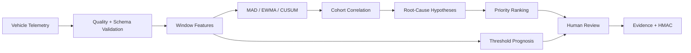

# Predictive Diagnostics Lab

A dependency-free Python workbench for explainable automotive fleet anomaly detection, degradation prognosis, cohort correlation, root-cause hypotheses and maintenance-investigation evidence.

> The included fleet is synthetic. Results are engineering hypotheses, not guaranteed failure predictions, maintenance orders, safety decisions or certification.

## Implemented

- typed signal catalogue with units, ranges and safety relevance
- bounded vehicle telemetry with per-vehicle timestamp ordering
- deterministic synthetic fleets segmented by variant, software version and operating cohort
- window features: mean, standard deviation, extrema, P95, slope and mean absolute delta
- robust median/MAD Z-score detector
- EWMA shift detector
- two-sided CUSUM change detector
- linear threshold-approach prognosis with explicit confidence
- cohort summaries and deviations by variant/software/cohort
- root-cause hypotheses concentrated by software version, variant and signal
- explainable severity and maintenance-investigation priority scoring
- baseline/candidate report comparison
- canonical SHA-256 evidence and optional HMAC-SHA256 signing
- JSON and CSV ingestion contracts
- bounded loopback REST API, optional bearer authentication and browser dashboard
- synthetic **100-vehicle × 40-sample = 4,000-record** demonstration
- **44 dependency-free Python tests**

## Quick start

Requires Python 3.11 or later.

```bash
python -m unittest discover -s tests -v
python -m compileall -q predictive_diagnostics tests
python -m predictive_diagnostics.cli --vehicles 100 --samples 40
python -m predictive_diagnostics.server
```

Open <http://127.0.0.1:8084>. Set `API_TOKEN` from a secret manager to require bearer authentication.

## API

| Method | Path | Purpose |
|---|---|---|
| GET | `/api/health` | Service health and version |
| GET | `/api/example` | Synthetic telemetry dataset |
| POST | `/api/analyses` | Analyze fleet telemetry |
| GET | `/api/analyses/{id}` | Retrieve report |
| GET | `/api/analyses/{id}/evidence` | Retrieve integrity envelope |
| POST | `/api/evidence/verify` | Verify evidence integrity |
| POST | `/api/compare` | Compare two retained analyses |

Bodies are limited to **10,000,000 bytes**, datasets to **1,000,000 records**, synthetic generation to **10,000 vehicles × 10,000 samples**, and retained analyses to **100**.

## Architecture



See [architecture](docs/architecture.md), [methods and limitations](docs/methods-and-limitations.md), and [threat model](docs/threat-model.md).

## Interpretation

A finding means a configured statistical method detected deviation from an observed baseline. Root-cause entries are hypotheses based on concentration—not proof of causation. Remaining-useful-sample projections are linear extrapolations and must not be converted into service intervals without target evidence and engineering review.

## Honest roadmap

Parquet/Arrow, MQTT, Kafka, DuckDB/Polars, scikit-learn models, multivariate covariance, survival analysis, richer RUL models, OTA-platform integration, persistent time-series storage, digital signatures/KMS, OIDC, tenant isolation and cloud fleet deployment are not implemented.

## Security, safety and licensing

The server binds to loopback, uses restrictive browser headers, bounds inputs, supports bearer authentication and has no vehicle-control interface. Never commit VINs, customer telemetry, production thresholds, credentials or signing keys. See [SECURITY.md](SECURITY.md).

This version is proprietary and source-available. Production, commercial, customer, vehicle, embedded-system or field use requires a separate written commercial license. See [LICENSE](LICENSE) or contact `nagaraj.rbhagwat@expleogroup.com` or an authorized Expleo Group representative. The initial historical MIT commit retains its prior grant.
